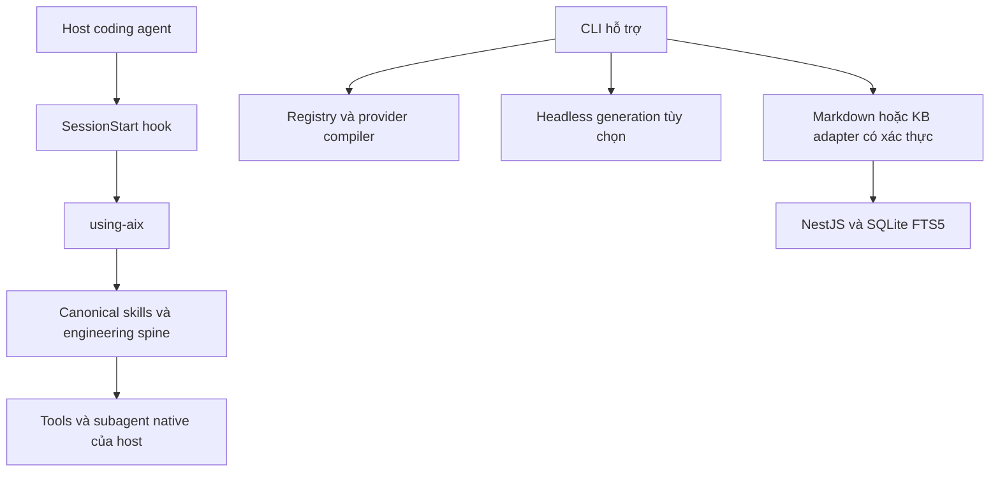

# Tổng quan dự án aix

## Mục tiêu và mô hình thực thi

**Host agent là runtime.** aix cung cấp phương pháp kỹ thuật tám bước và thư viện skill;
không yêu cầu engine headless để dùng plugin. Thư viện canonical hiện có **158 SKILL.md**
trong [content/skills/](content/skills/). Các file `skills/*.md` ở root là bản mirror cũ,
không phải một thư viện bổ sung hay nguồn authoring thứ hai.



## Cấu trúc

| Khu vực | Vai trò |
|---|---|
| [.claude-plugin/](.claude-plugin/) và [.codex-plugin/](.codex-plugin/) | Manifest plugin |
| [hooks/](hooks/) | Inject skill nhập môn; yêu cầu KB startup tùy chọn nếu CLI đã build |
| [content/](content/) | Nguồn canonical của skill, rule và workflow |
| [packages/](packages/) | 13 package TypeScript quản lý bằng pnpm/Turborepo |
| [services/kb-server/](services/kb-server/) | NestJS, SQLite/FTS5, cache trong process |
| [apps/docs/](apps/docs/) | Tài liệu VitePress |
| [apps/todo-sync/](apps/todo-sync/) | Demo WebSocket riêng |

Các package nền tảng: `@x/core` (type/phase/budget), `@x/registry` (schema/catalog),
`@x/policy` (redaction/denylist), `@x/providers` (adapter và API client), `@x/compiler`
(emitter), `@x/context`, `@x/memory`, `@x/prompt`, `@x/engine`, `@x/evals`, `@x/hitl`,
`@x/preview` và `@x/cli`. Chi tiết tại [Architecture](apps/docs/guide/architecture.md).

## Engineering spine của host

1. Align & Shape — `discussing-pro`.
2. Plan — `planning-pro`.
3. Isolate — `git-worktree-pro`.
4. Test-first — `ttd-pro`.
5. Execute — `executing-pro`.
6. Review — `code-review-pro`.
7. Verify — `verify-pro`.
8. Remember — `remember-pro`.

Đây là workflow hướng dẫn host agent; không đồng nhất với phase machine của engine.
Artifact của một phiên nằm trong `.aix/sessions/<session-id>/`.

## Generation khác verification

```bash
pnpm install --frozen-lockfile --ignore-scripts
pnpm build
node packages/cli/dist/index.js run "<task>" --auto
node packages/cli/dist/index.js verify <session-id> --command "<lệnh kiểm chứng của bạn>"
```

Engine sinh file trong `generated/`, không ghi đè source dự án. Điểm review chỉ là heuristic
về văn bản, không chứng minh tính đúng. Mọi task pending được xử lý trong giới hạn budget và
approval; trạng thái generation `done` không có nghĩa test pass. Lệnh verify chạy command do
người dùng chỉ định trong sandbox output, lưu exit code/output đã redact và hash file.
Không có lệnh ship/deploy hay khẳng định shipping giả lập.

## Knowledge base và an toàn dữ liệu

Service hiện dùng SQLite/FTS5 và cache in-memory; không cần Neo4j/Meilisearch/Redis.
Route memory yêu cầu API key hoặc master password; shutdown chỉ chấp nhận master password.
Listener standalone mặc định loopback. CLI tạo credential quản trị ngẫu nhiên, lưu riêng tư,
và chỉ tự dừng service do chính process đó khởi động.

Metadata/session/checkpoint và memory được redact trước khi ghi. Generated source có secret
nhận diện được sẽ bị từ chối thay vì bị sửa âm thầm. Redaction dựa trên pattern, không thay
thế việc tránh đưa secret thật vào prompt. Hướng dẫn vận hành tại
[KB Server](apps/docs/guide/kb-server.md) và [CLI Reference](apps/docs/reference/cli.md).
