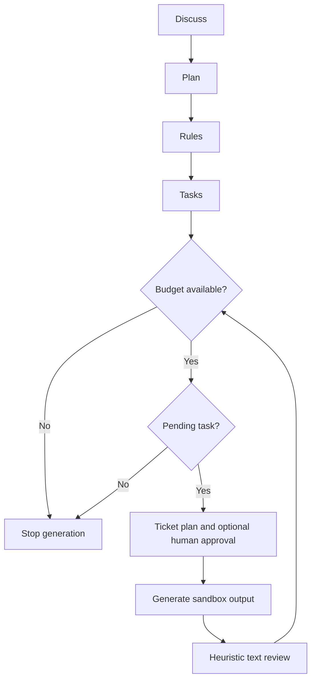

# Headless Generation and Verification

`@x/engine` is an optional LangGraph runner for generating artifacts without a host-agent
session. It is not an implementation of every host methodology step, an OS sandbox, or a
replacement for task-specific tests.

## Generation flow



## Nodes and boundaries

| Node | Behavior |
|---|---|
| Discuss / Plan | Calls the provider and persists sanitized metadata artifacts |
| Rules / Tasks | Selects rules and materializes planned generation tasks |
| Pick / Ticket plan | Selects pending work and prepares target paths/acceptance text |
| Coder | Accounts for provider usage; rejects secret-bearing source before writing |
| Reviewer | Assigns a text-structure/word-overlap score; does not run a compiler or tests |

A high score does not end work while tasks remain. There is no global three-task attempt
cap. Model budget/context checks and explicit interruption still constrain execution.
Generated task status `done` means **generation finished**, not verified correctness.

Generated code lives under `.aix/sessions/<id>/generated/`, never directly in project source.
Discussion/plan prose, state content and checkpoint content are sanitized before persistence.
Accepted identifiers and operational file references are preserved so resume/verification
can find the actual artifacts; recognized secret-bearing identifiers/paths are rejected.
The file checkpointer saves under the session's `checkpoints/` directory; it is not the
in-process MemorySaver described in older releases.

## Explicit verification

```bash
aix run "<task>" --auto
aix verify <session-id> --command "node --test"
```

Choose a command that actually checks the generated deliverable and its acceptance criteria.
The command runs with `generated/` as working directory using your user permissions; it is
trusted user-supplied code, not a model-selected command or an isolation boundary. It must
have the dependencies and test files it needs inside/reachable from that environment.

Verification refuses missing sessions, incomplete generation or missing output. It records
actual exit status, redacted stdout/stderr and SHA-256 hashes of generated outputs. A failing
recheck replaces earlier success. Output changing during the check fails verification and
must be checked again when stable. An arbitrary command exiting zero is not independent
proof of requirements. Nothing is automatically shipped or copied to project source.

## API

```typescript
import { EngineGraph, createInitialEngineState } from '@x/engine';

const engine = new EngineGraph();
const result = await engine.run(createInitialEngineState(session));
const resumed = await engine.resume(savedState);
```

These methods generate/resume artifacts; they do not create executable verification evidence.
